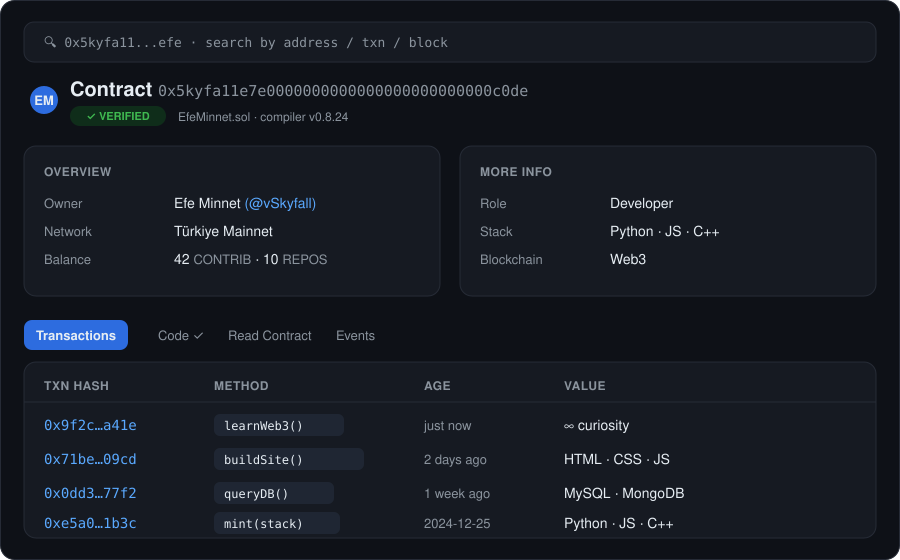

[README.md](https://github.com/user-attachments/files/34320378/README.md)
<!-- ID card -->

  

  
  
  

<!-- Contract explorer -->

  

###### TECH STACK

  

###### DATABASES

  

###### STATS

  
  

  

<!--
###### CONNECT

  
  
  

-->

